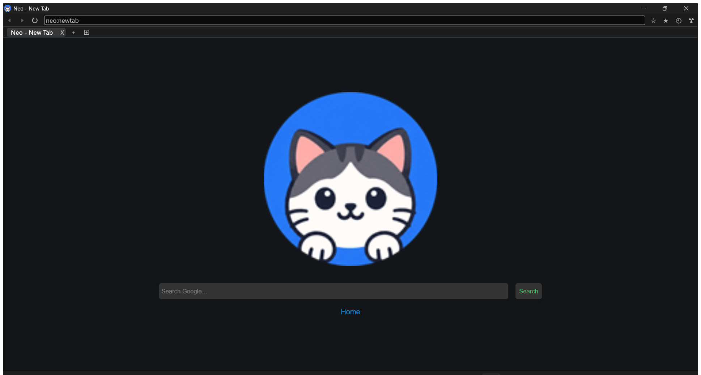
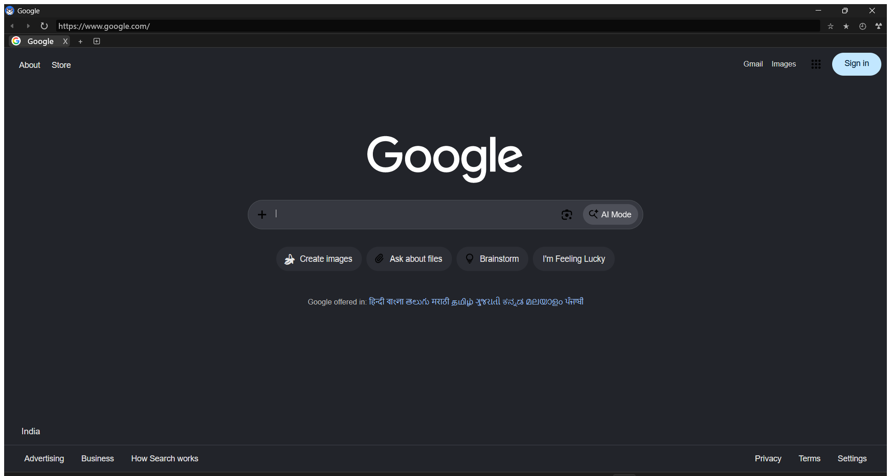
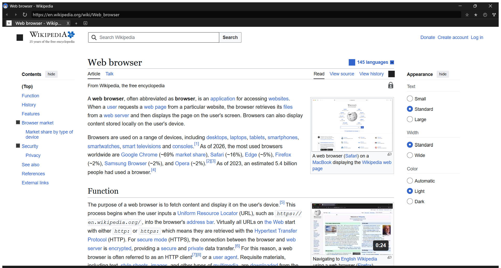

<p align="center">
  
</p>

<h1 align="center">Neo</h1>

<p align="center">
  <strong>An independent browser — built in Rust on the Servo engine.</strong>
</p>

<p align="center">
  <a href="LICENSE"></a>
  
  
</p>

---

Neo is a desktop web browser whose engine is **neither Chromium, WebKit, nor Gecko** — it is built on the [Servo](https://github.com/servo/servo) engine, packaged with its own identity, defaults, and UI. It loads real websites, plays native HLS/DASH video, and ships working tabs, bookmarks, history, and preferences. It is also honest about its limits (see [Limitations](#-limitations)).

**Disclaimer:** Neo is an independent project derived from Servo. It is not affiliated with, or endorsed by, Mozilla, the Servo Project, or Google.

## Table of contents

- [Feature overview](#feature-overview)
- [Limitations](#-limitations)
- [Screenshots](#-screenshots)
- [Technology stack](#-technology-stack)
- [Installation and setup](#-installation-and-setup)
- [Running Neo locally](#-running-neo-locally)
- [Controls and CLI](#-controls-and-cli)
- [Security and privacy](#-security-and-privacy)
- [Testing](#-testing)
- [Roadmap](#-roadmap)
- [Contributing](#-contributing)
- [License](#-license)
- [Acknowledgments](#-acknowledgments)

**Legend:** 🚧 = not implemented. Anything with no marker is implemented and was verified.

---

## Feature overview

### Tabs and navigation

| Feature | What it does |
| --- | --- |
| Tab strip | Open tabs with page titles, favicons, a loading indicator, and a per-tab close button. |
| Keyboard tab control | `Ctrl+T` new tab, `Ctrl+W` close tab, `Ctrl+1…8` jump, `Ctrl+9` last tab, `Ctrl+PageUp/PageDown` cycle. |
| Address bar | Full URLs, bare domains (`example.com` → `https://example.com`), local file paths, or web search fallback. Unit-tested in `ports/servoshell/test.rs`. |
| Back / forward / reload | Toolbar buttons, `Alt+←` / `Alt+→`, mouse back/forward buttons, `Ctrl+R`, `F5`. |
| Reload all tabs | Toolbar command re-loads every open tab. |
| Startup URL | `neo.exe <url-or-query>` opens it; no argument opens the homepage (default: `https://www.google.com`). |
| New tab page | Neo-branded `neo:newtab` with the logo and a Google search box (`Ctrl+T` or the new-tab button). |

### Bookmarks and history

| Feature | What it does |
| --- | --- |
| Bookmark toggle | Toolbar star bookmarks/un-bookmarks the current page. |
| Bookmarks panel | Side panel listing saved bookmarks; click to navigate. |
| Persistent bookmarks | Saved as `bookmarks.json` in Neo's config directory. |
| Browsing history | Visits recorded automatically (URL + title + time). |
| History panel | Side panel with a **live text filter**; click an entry to visit it. |
| Persistent history | Saved as `history.json` in Neo's config directory. |

### Settings and preferences

| Feature | What it does |
| --- | --- |
| Preferences page | `neo:preferences` — experimental-feature toggles, HTTP-cache switch, and a **user-agent selector** (Neo / Firefox / Chrome presets + custom). |
| Preferences toggle | Toolbar `?` button enables/disables the experimental preference set instantly. |
| Raw config view | `neo:config` renders the active preference JSON. |
| Homepage + search engine | `homepage` and `searchpage` (`%s` query placeholder); defaults are Google. Overridable via prefs file and CLI. |
| Command-line switches | Layout threads (`-y`), headless (`-z`), devtools, experimental features, certificate-error override, hosts-file override, device-pixel-ratio, and more — see `--help`. |

### Media and graphics

| Feature | What it does |
| --- | --- |
| HTML5 `<video>` / `<audio>` | GStreamer backend integrated into the engine. |
| Direct files | Progressive files such as MP4 play via `<video src="…mp4">`. |
| HLS adaptive streaming | `.m3u8` playlists play through `<video>` **without MSE** (verified: Apple 1080p `img_bipbop`). |
| DASH adaptive streaming | `.mpd` manifests play through `<video>` (verified: Akamai `bbb_30fps`). |
| Multiple simultaneous streams | Verified: three concurrent `<video>` elements (HLS + DASH + MP4) all reach `readyState = 4` and advance. |
| GPU compositing | WebRender over OpenGL/ANGLE (Direct3D 11 on Windows). |
| WebGL / WebGPU (Experimental) / WebXR | Enabled by default; maturity varies by site. |
| Gamepad API (Experimental) | Enabled by default (`gilrs` backend). |
| Rendering debug overlays | `F9` WebRender capture, `F10` render targets, `F11` texture cache, `F12` profiler. |

### Developer tooling

| Feature | What it does |
| --- | --- |
| W3C WebDriver | `--webdriver <port>` starts a WebDriver server (sessions, navigation, JS, window handles, screenshots); works with any W3C client. |
| Remote DevTools | `--devtools <address:port>` starts Servo's remote devtools server (compiled in; not smoke-tested here). |
| Headless mode 🚧 | `-z` flag exists in the CLI (inherited; untested). |
| Logging | `env_logger` filtering — `RUST_LOG=info` or module filters like `RUST_LOG=net=debug`. |

### Interface and platform

| Feature | What it does |
| --- | --- |
| Custom chrome | Toolbar, tab strip, side panels, and dialogs rendered with `egui`; Servo renders page content only. |
| Site dialogs | Alert/confirm/prompt, file pickers, HTTP auth, permission requests, select popups, color pickers, context menus. |
| `neo:` internal pages | `neo:newtab`, `neo:preferences`, `neo:config`, `neo:experimental-preferences`, `neo:default-user-agent`. |
| Branding | `neo.exe`, Neo window titles, Windows app identity, Neo icon (`resources/neo.ico`). |
| Accessibility | AccessKit integration compiled into the shell. |

---

## 🚧 Limitations

The **complete, honest list** of what Neo cannot do today — so this README never over-promises. Planned fixes are in the [Roadmap](#-roadmap).

### Web platform and media

- **No YouTube playback.** YouTube's player depends on MSE (next bullet) and cannot work in this engine today.
- **No Media Source Extensions (MSE).** MSE-driven players will not play video — an engine-level gap in the script layer, not a configuration problem.
- **JavaScript player libraries therefore fail.** `hls.js`, `dash.js`, Shaka Player, and similar MSE-based libraries do not work — even though native `<video>` handling of `.m3u8`/`.mpd` URLs works.
- **No EME / DRM.** Netflix, Disney+, Spotify web player, and every Widevine/FairPlay stream cannot play.
- **No WebRTC for web pages.** `RTCPeerConnection` is not exposed to page script — video calls and WebRTC data channels do not work.
- **No WebExtensions.** No ad blockers, password managers, or other add-ons.
- **Experimental web features are immature.** WebGPU, WebXR, Gamepad API, and AccessKit are on by default but not production-grade.

### Missing everyday features

- **No download manager.** File downloads go nowhere; the HTML `download` attribute is an explicit `TODO` (`components/script/dom/html/textual/htmlanchorelement.rs`).
- **No find-in-page** (`Ctrl+F`).
- **No session/tab restore** across restarts.
- **No password manager, autofill, form-data capture, or sync.**
- **No cookie or site-data UI** (cookies work in the network stack; no inspector).
- **No search-engine picker UI** (change `searchpage` via preferences or CLI).
- **No tab pinning**, tab groups, or drag-reordering.
- **No printing.**
- **No built-in PDF viewer.**
- **No spellcheck.**
- **No multiple-window management UI** (popups/`target=_blank` are handled by the embedder only).

### Reliability quirks

- **Minimize-while-playing media under investigation** — minimizing logs a `0×0` surface-resize warning from `paint_api`.
- **Heavy pages can briefly spike memory** while textures queue up; normal browsing stays in the low hundreds of MB.
- **Headless mode (`-z`) is untested** in this fork.

### Platform and project scope

- **Windows is the only verified platform** (Windows 11 x86_64 MSVC); macOS/Linux code paths are retained but untested here.
- **Linux config directory is still upstream's** `~/.config/servo/default/`.
- **No WPT suite included, no CI yet** — claims rest on manual verification and the shell's unit tests.
- **DevTools compiled in but not smoke-tested.**
- **Site compatibility not systematically tested** (verified: Google, Apple/Akamai HLS/DASH streams, general pages).
- **Builds are unsigned** — occasional AV false positives possible.

### Security boundaries

(Expanded in [Security and privacy](#-security-and-privacy):)

- **No Chromium-style OS sandbox** — relies on Rust memory safety, not OS site isolation.
- **WebDriver binds `0.0.0.0`** when enabled — trusted networks only.
- **Defaults contact Google** — default homepage and search are Google.

---

## 📸 Screenshots

Real screenshots from the build on Windows 11 — no mockups.

**New tab (`neo:newtab`):**



**Default homepage:**



**Wikipedia rendered in Neo:**



---

## 🧰 Technology stack

| Layer | Technology |
| --- | --- |
| Language | **Rust** (pinned **1.97.1** via `rust-toolchain.toml`) |
| Browser engine | **Servo** — engine (`components/`) + shell (`ports/servoshell/`) |
| JavaScript engine | **SpiderMonkey** |
| CSS / style | **Stylo** |
| DOM & scripting | `components/script` |
| Networking | `components/net` — HTTP, cookies, HSTS, cache |
| Compositor | **WebRender** over **surfman** / **ANGLE** (Direct3D 11 on Windows) |
| Media | **GStreamer** — MP4, HLS, DASH |
| Browser chrome UI | **egui** in a **winit** event loop |
| CLI parsing | **bpaf** |
| Persistence | `serde_json` — `prefs.json`, `history.json`, `bookmarks.json` |
| Bindings | `bindgen` (needs `LIBCLANG_PATH` → LLVM libclang) |
| Build | **Cargo** |

---

## 🛠 Installation and setup

### Prerequisites (Windows, primary platform)

1. **Rust** — [rustup](https://rustup.rs/); the pinned toolchain installs automatically on first build.
2. **Visual Studio 2022 Build Tools** with *Desktop development with C++* (MSVC v143 + Windows 10/11 SDK).
3. **LLVM** — `libclang` (for `bindgen`) and `lld-link`.
4. **GStreamer 1.x** — MSVC x86_64 *development* and *runtime* installers from [gstreamer.freedesktop.org](https://gstreamer.freedesktop.org/download/).
5. **Python 3** — the engine's WebIDL bindings codegen runs a Python script during `cargo build`.

### Clone and build

```powershell
git clone https://github.com/rishabhhgit/neo-browser.git
cd neo-browser

# from an "x64 Native Tools Command Prompt for VS 2022", or set these yourself:
$env:LIBCLANG_PATH = "C:\Program Files\LLVM\bin"
$env:GSTREAMER_1_0_ROOT_MSVC_X86_64 = "C:\gstreamer\1.0\msvc_x86_64"
$env:PKG_CONFIG_PATH = "$env:GSTREAMER_1_0_ROOT_MSVC_X86_64\lib\pkgconfig"

cargo build --release -p servoshell
```

- Default features (`default_base`, `jemalloc`, `media-gstreamer`) are what Neo ships.
- If `lld-link.exe` is not on `PATH`, add LLVM's `bin` or set `$env:CARGO_TARGET_X86_64_PC_WINDOWS_MSVC_LINKER` to MSVC's `link.exe`.
- Optional: set `$env:CARGO_TARGET_DIR` to relocate build output.

### Common setup issues

| Symptom | Fix |
| --- | --- |
| `pkg-config` errors for GStreamer | Set `GSTREAMER_1_0_ROOT_MSVC_X86_64` + `PKG_CONFIG_PATH`; use the **MSVC** GStreamer build, not MinGW. |
| `libclang` / bindgen errors | Set `LIBCLANG_PATH` to LLVM's `bin`. |
| `link.exe not found` / LNK errors | Build from the *x64 Native Tools* prompt or set `CARGO_TARGET_X86_64_PC_WINDOWS_MSVC_LINKER`. |
| `Access is denied` replacing `neo.exe` | A Neo instance is running — close it. |
| Video never plays | GStreamer runtime DLLs/plugins missing — install the runtime or copy its `bin` next to `neo.exe`. |
| Black/blank rendering | Ensure `libEGL.dll` / `libGLESv2.dll` (ANGLE) sit next to `neo.exe`. |
| AV quarantine | Unsigned builds may trip heuristics; build from source as shown. |

---

## ▶️ Running Neo locally

```powershell
target\release\neo.exe                      # homepage (Google by default)
target\release\neo.exe https://example.com  # open a specific page
target\release\neo.exe --webdriver 4444     # automation endpoint
target\release\neo.exe --help               # all CLI options
```

**Runtime libraries** next to `neo.exe` (or on `PATH`):

- **GStreamer runtime** — its `bin` directory (for HLS/DASH: `gsthls`, `gstdash`, `gstfmp4`, `gstmpegtsdemux`, `gstsoup` + deps).
- **ANGLE** — `libEGL.dll` / `libGLESv2.dll`.

Data lives in the config directory (Windows: `%APPDATA%\Neo\`; macOS: `~/Library/Application Support/Neo/`; Linux: `~/.config/servo/default/`).

---

## 🕹 Controls and CLI

| Action | Control |
| --- | --- |
| New / close tab | `Ctrl+T` / `Ctrl+W` |
| Switch tabs | `Ctrl+1…9`, `Ctrl+PageUp` / `Ctrl+PageDown` |
| Back / forward | `Alt+←` / `Alt+→`, toolbar, mouse buttons |
| Reload | `Ctrl+R` / `F5` |
| Zoom in / out / reset | `Ctrl+=` / `Ctrl+-` / `Ctrl+0` |
| Quit | `Ctrl+Q` |
| Bookmarks / history panels | Toolbar star / clock buttons |
| Preferences / config | `neo:preferences` / `neo:config` in the address bar |
| WebRender debug | `F9` capture · `F10` targets · `F11` textures · `F12` profiler |

| CLI flag | Purpose |
| --- | --- |
| `[URL]` | Startup URL or search query |
| `--webdriver <port>` | W3C WebDriver server (see security note) |
| `--devtools <addr:port>` | Remote devtools server |
| `--enable-experimental-web-platform-features` | Experimental preference set at startup |
| `-y, --layout-threads <n>` | Layout thread count |
| `-z, --headless` | Headless mode |
| `--ignore-certificate-errors` | ⚠ Disable TLS validation (testing only) |
| `--prefs-file <path>` | Merge extra preferences from JSON |

Run `neo.exe --help` for the full list.

---

## 🔐 Security and privacy

**What Neo does:**

- **No telemetry, analytics, or crash-reporting** of its own.
- **Your data stays local** — history, bookmarks, preferences are plain JSON files; no accounts, no sync.
- **TLS validation on by default** (`--ignore-certificate-errors` must be explicit).
- Standard building blocks: cookie handling, HTTPS/HSTS (`components/net`).

**What you should know:**

- ⚠ **Default homepage/search are Google** — a stock launch contacts Google. Change `homepage`/`searchpage` or pass a startup URL.
- ⚠ **WebDriver binds `0.0.0.0`** — enable only on trusted networks; disable when not automating.
- ⚠ **No OS sandbox** — no Chromium-style site isolation; browse untrusted sites with care.
- ⚠ **Derivative of Servo** — inherits its security properties and bug surface. Report issues here first ([SECURITY.md](SECURITY.md)).

---

## 🧪 Testing

```powershell
cargo test --release -p servoshell
```

**Result on this codebase (Windows 11, MSVC, release):** `9 passed; 0 failed` — address-bar/URL parsing and preference/CLI handling. Use `--release` to reuse the built dependency graph.

Debug logging:

```powershell
$env:RUST_LOG = "info"   # or e.g. "net=debug,script=debug"
target\release\neo.exe
```

---

## 🗺 Roadmap

None of this is implemented yet:

- [ ] Session restore
- [ ] Find in page (`Ctrl+F`)
- [ ] Downloads (honor `download` attribute → download manager UI)
- [ ] Minimize/occlusion robustness
- [ ] Site compatibility pass with a public status page
- [ ] CI (build + unit tests)
- [ ] Release binaries (tagged releases with prebuilt `neo.exe`)
- [ ] MSE scoping study (large effort; no commitment)
- [ ] Cookie/site-data inspector
- [ ] Search-engine picker UI

---

## 🤝 Contributing

Bug reports, fixes, docs, and features are welcome — see [CONTRIBUTING.md](CONTRIBUTING.md). Quick version: fork, `cargo fmt`, `cargo test --release -p servoshell`, one focused change per PR, fill in [PULL_REQUEST_TEMPLATE.md](PULL_REQUEST_TEMPLATE.md). Read [CODE_OF_CONDUCT.md](CODE_OF_CONDUCT.md) first.

---

## 📄 License

**Mozilla Public License 2.0** — see [LICENSE](LICENSE). Neo is a derivative work of the [Servo Project](https://servo.org/), also MPL-2.0; original Servo files retain their MPL headers.

---

## 🙏 Acknowledgments

- **[Servo](https://github.com/servo/servo)** — the engine Neo is built on.
- **[Mozilla](https://www.mozilla.org/)** — originator of Stylo and SpiderMonkey.
- **[WebRender](https://github.com/servo/webrender)**, **[GStreamer](https://gstreamer.freedesktop.org/)**, **[egui](https://github.com/emilk/egui)**, **[winit](https://github.com/rust-windowing/winit)**, **[bpaf](https://github.com/pacak/bpaf)**, and the crates in `Cargo.lock`.

**Links:** [Repository](https://github.com/rishabhhgit/neo-browser) · [Issues](https://github.com/rishabhhgit/neo-browser/issues) · [Releases](https://github.com/rishabhhgit/neo-browser/releases)

---

<p align="center">
  <strong>Neo is an independent browser because the web deserves more than three engines.</strong>
</p>
